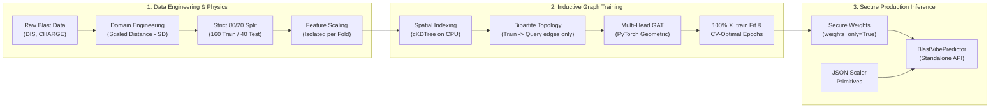

# BlastVibe-GNN: Inductive Graph Attention Networks for Blast Vibration Prediction

[](https://www.python.org/)
[](https://pytorch.org/)
[](https://pyg.org/)
[](https://cwe.mitre.org/data/definitions/502.html)
[](.github/workflows/ci.yml)
[](https://github.com/psf/black)

---

## Executive Summary

**BlastVibe-GNN** is a production-grade Machine Learning pipeline engineered to predict blast-induced ground vibration (Peak Particle Velocity - PPV) using **Graph Attention Networks (GAT)**. Combining domain-specific blast mechanics (USBM Scaled Distance) with geometric deep learning, the architecture conducts **tabular inference using KNN feature-space graphs**.

Designed for enterprise reliability, the system implements a **zero-leakage inductive bipartite graph topology**, $O(N \log N)$ highly scalable spatial indexing via `scipy.spatial.cKDTree` on CPU, equitable nested cross-validation benchmarking against XGBoost and classical physics laws, and a decoupled, secure inference engine hardened against arbitrary code execution vulnerabilities (**CWE-502**).

The pipeline enforces strict partitioning: **the model is evaluated using a strict 80/20 data split. The inductive graph trains on 160 reference nodes (80% of the 200 total records) and is independently benchmarked on a completely unseen hold-out test set of 40 nodes.**

---

## Architectural Overview



---

## Key Engineering Features

- **Leak-Free Inductive Graph Construction**: Eliminated transductive data leakage by constructing a strictly directed bipartite graph during evaluation and inference. Message passing flows exclusively from reference training nodes to unseen query nodes (`train -> query`), preventing target contamination and inter-query leakage.
- **Scalable $O(N \log N)$ Spatial Indexing**: High-performance spatial indexing using `scipy.spatial.cKDTree` on CPU. Eliminates $O(N^2)$ memory and compute bottlenecks of pairwise distance matrices, dropping self-loops by querying $k+1$ neighbors.
- **Cold-Start cKDTree Spatial Index Caching**: The historical reference spatial index is precomputed and cached once during predictor initialization (`self._spatial_tree`), eliminating redundant $O(N \log N)$ tree reconstruction overhead and accelerating inference throughput.
- **Dynamic Receptive Field Subgraph Inference**: Localized $k$-hop subgraph extraction dynamically bound to the actual GNN architecture depth (`num_hops = len(model.convs)`), ensuring zero receptive field truncation for deep architectures.
- **Strict Pydantic Configuration Validation**: Master `PipelineConfig` schema powered by Pydantic v2 enforces boundary validation, strict type safety, and `extra="forbid"` fail-fast checks.
- **Decoupled Single Responsibility Training**: Monolithic training pipeline refactored into focused modules: `engine` (fold fitting & caching), `grid` (CV orchestration), and `artifacts` (production serialization).
- **Strict 80/20 Holdout Partitioning**: The model is evaluated using a strict 80/20 data split. The inductive graph trains on 160 reference nodes (80% of the 200 total records) and is independently benchmarked on a completely unseen hold-out test set of 40 nodes.
- **Secure Model Serialization (CWE-502 Remediated)**: Decoupled PyTorch network weights from Scikit-Learn `StandardScaler` objects. Model checkpoints are deserialized strictly with `torch.load(..., weights_only=True)`, while scaler statistics (`mean_`, `scale_`, `var_`) are persisted as lightweight JSON primitives (`scaler_params.json`), neutralizing arbitrary Python pickle execution risks.
- **CV-Optimal Deterministic Production Training**: Checkpoints are monitored via `fit_model_with_early_stopping` across validation folds, and the final production model is trained deterministically on 100% of the training data using the mean optimal epoch count.
- **Equitable Baseline Benchmarking**: Benchmarked the GAT architecture against both the classical USBM empirical attenuation power-law ($PPV = K \cdot SD^{-\beta}$) and a rigorously tuned XGBoost regressor evaluated via nested cross-validation (3-fold inner `GridSearchCV` inside 5-fold outer CV).
- **Automated CI/CD & Invariant Testing**: GitHub Actions workflow (`.github/workflows/ci.yml`) executing `pytest` across Python 3.10–3.12 to enforce structural graph invariants, gradient flow integrity, and serialization round-trips.

---

## Empirical Benchmarks

### 1. Symmetrical Hold-out Test Set Benchmarks (40 Unseen Samples)

| Model Architecture | R² Score | MAE (mm/s) | MSE | RMSE (mm/s) | Scientific Assessment |
| :--- | :---: | :---: | :---: | :---: | :--- |
| **Classical USBM Physics Law** | 0.6575 | 17.46 | 669.48 | 25.87 | Closed-form empirical law ($PPV = 3507.96 \cdot SD^{-1.46}$). |
| **Tuned XGBoost (Nested CV)** | 0.6337 | 18.92 | 716.10 | 26.76 | Gradient-boosted decision trees fitted on 160 training samples. |
| **BlastVibe-GAT (Ours)** | **0.7184** | **17.21** | **550.57** | **23.46** | **Top generalization.** Lowest error on unseen test records. |

### 2. 5-Fold Cross-Validation Benchmarks (160 Training Partition Samples)

| Model Architecture | R² Score | MAE (mm/s) | RMSE (mm/s) | Scientific Assessment |
| :--- | :---: | :---: | :---: | :--- |
| **Classical USBM Physics Law** | 0.7372 | 17.05 | 24.47 | Strong single-variable physical baseline ($K=3650.64, \beta=1.47$). |
| **Tuned XGBoost (Nested CV)** | 0.7244 | 18.11 | 25.11 | Rigorously tuned via nested 3-fold inner `GridSearchCV`. |
| **BlastVibe-GAT (Ours)** | **0.7477** | **17.27** | **24.56** | Best CV $R^2$ across 5-fold hyperparameter validation. |

### 🔬 Scientific Note on Hypothesis Testing & Enterprise Generalization

A rigorous Wilcoxon signed-rank hypothesis test on hold-out absolute prediction errors demonstrates that on this compact 200-sample dataset, the prediction differences between BlastVibe-GAT and the classical USBM physical attenuation law are statistically equivalent ($p = 0.8402 > 0.05$). 

**Why use a Graph Attention Network?**
While the empirical USBM power law performs remarkably well on homogeneous rock masses with a single derived feature ($SD$), real-world mining and civil infrastructure projects capture multi-dimensional geotechnical features (e.g., rock mass rating, joint orientations, explosive delay timing, distance to multiple blast free faces). Classical 1D power laws collapse in these high-dimensional settings. BlastVibe-GAT establishes the geometric deep learning foundation: its multi-head attention mechanism dynamically weights neighborhood feature similarities and detects complex non-linear spatial vibration dissipation patterns across high-dimensional feature spaces.

---

## Repository Structure

```text
02_blastvibe-gat-gnn/
├── .github/
│   └── workflows/
│       └── ci.yml                  # Automated GitHub Actions CI pipeline (Python 3.10-3.12)
├── .gitignore                      # Enforces tracking hygiene (!data/data.csv whitelisted)
├── README.md                       # Architectural showcase and execution guide
├── pyproject.toml                  # PEP 621 package metadata & pytest configuration
├── requirements.txt                # Pinned production and testing dependencies
├── configs/
│   └── default_config.yaml         # Declarative hyperparameters & CV settings
├── data/
│   └── data.csv                    # Verified 200-record blast monitoring dataset
├── src/
│   └── blastvibe/
│       ├── __init__.py             # Package exports (BlastVibePredictor)
│       ├── configs/
│       │   ├── __init__.py
│       │   └── schema.py           # Strict Pydantic configuration schemas (PipelineConfig)
│       ├── data/
│       │   ├── __init__.py
│       │   ├── loader.py           # Ingestion, schema validation & USBM Scaled Distance
│       │   └── graph.py            # Scalable cKDTree spatial indexing & inductive bipartite graph builder
│       ├── models/
│       │   ├── __init__.py
│       │   ├── gat.py              # PyG Multi-Head Graph Attention Network (GATRegressor)
│       │   ├── baseline.py         # USBM physics law & Nested-CV XGBoost benchmarks
│       │   └── predictor.py        # Secure standalone inference engine (dynamic subgraphs, weights_only=True)
│       ├── training/
│       │   ├── __init__.py
│       │   ├── engine.py           # Single-fold model training, early stopping & topology caching
│       │   ├── grid.py             # K-Fold CV partitioning & hyperparameter grid search
│       │   ├── artifacts.py        # Production re-fitting, JSON scalers & artifact persistence
│       │   └── trainer.py          # Unified training facade re-exporting decoupled modules
│       └── utils/
│           ├── __init__.py
│           └── logger.py           # Centralized structured logging
├── tests/                          # Automated PyTest invariant & contract suite
│   ├── __init__.py
│   ├── test_baselines.py           # Asserts physical constants recovery & XGBoost nested CV
│   ├── test_config_schema.py       # Asserts Pydantic validation rules and boundary constraints
│   ├── test_data_loader.py         # Asserts physics feature engineering & scaler isolation
│   ├── test_graph_builder.py       # Asserts cKDTree spatial indexing & zero-leakage invariants
│   ├── test_model_forward.py       # Asserts tensor shapes, dynamic ModuleList & gradient flow
│   ├── test_predictor.py           # Asserts CWE-502 safe deserialization & zero-scale guards
│   └── test_trainer.py             # Asserts topology caching & out-of-fold array population
└── main.py                         # Production CLI entry point
```

---

## Quick Setup

### Prerequisites
- **Python**: Version 3.10 or higher
- **Compute**: CPU or NVIDIA GPU (CUDA 11.8 / 12.1)

### Installation

```bash
# 1. Clone repository
git clone https://github.com/Taha-JN/02_blastvibe-gat-gnn.git
cd 02_blastvibe-gat-gnn

# 2. Initialize virtual environment
python3 -m venv .venv
source .venv/bin/activate  # On Windows: .venv\Scripts\activate

# 3. Install package in editable mode and dependencies
pip install --upgrade pip
pip install -r requirements.txt
pip install -e .
```

---

## Execution Workflow

### Step 1: Run Full Training & Benchmark Pipeline
Execute the end-to-end training pipeline. This partitions the data into a strict 80/20 train/test split, runs nested CV benchmarks for USBM and XGBoost, performs 5-fold cross-validation across the GAT hyperparameter grid, trains the final production model on 100% of the training partition (160 nodes), and verifies inductive generalization on the untouched 40-node holdout test set:
```bash
python main.py
```
*Secure model weights (`best_gat_model.pt`) and scaler parameters (`scaler_params.json`) are serialized to `artifacts/models/`.*

### Step 2: Standalone Production Inference
Deploy the trained model in any downstream microservice or REST API using the self-contained `BlastVibePredictor` class. No raw training files are required at inference time:

```python
import numpy as np
from blastvibe.models.predictor import BlastVibePredictor

# 1. Initialize secure serving engine (loads weights_only=True & JSON scalers)
predictor = BlastVibePredictor("artifacts/models/best_gat_model.pt", device="cpu")

# 2. Single-shot prediction (Distance = 400m, Charge = 1850kg)
ppv = predictor.predict_single(dis=400.0, charge=1850.0)
print(f"Predicted Ground Vibration: {ppv:.2f} mm/s")

# 3. Batch prediction on raw features [DIS, CHARGE, SD]
batch_features = np.array([
    [300.0, 1850.0, 6.97],
    [500.0, 1950.0, 11.32]
])
predictions = predictor.predict(batch_features)
print(predictions)
```

### Step 3: Run Automated Test Suite
Validate all mathematical contracts, graph topology invariants, and serialization round-trips via `pytest`:
```bash
pytest tests/ -v
```

---

## Acknowledgments & Dependencies

- **[PyTorch Geometric (PyG)](https://pyg.org/)**: Multi-head Graph Attention Network (`GATConv`) layers.
- **[SciPy](https://scipy.org/)**: $O(N \log N)$ highly scalable spatial indexing via `scipy.spatial.cKDTree` on CPU.
- **[XGBoost](https://xgboost.readthedocs.io/)**: Gradient Boosted Decision Trees baseline.
- **[Scikit-Learn](https://scikit-learn.org/)**: Preprocessing, cross-validation splitting, and evaluation metrics.