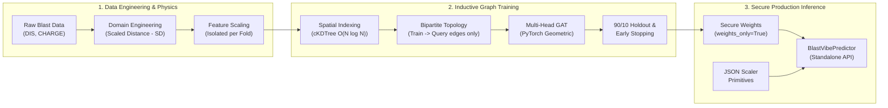

# BlastVibe-GNN: Inductive Graph Attention Networks for Blast Vibration Prediction

[](https://www.python.org/)
[](https://pytorch.org/)
[](https://pyg.org/)
[](https://cwe.mitre.org/data/definitions/502.html)
[](.github/workflows/ci.yml)
[](https://github.com/psf/black)

---

## 📖 Executive Summary

**BlastVibe-GNN** is a production-grade Machine Learning pipeline engineered to predict blast-induced ground vibration (Peak Particle Velocity - PPV) using **Graph Attention Networks (GAT)**. Combining domain-specific blast mechanics (USBM Scaled Distance) with geometric deep learning, the architecture models spatial energy dissipation across monitoring networks.

Designed for enterprise reliability, the system implements a **zero-leakage inductive bipartite graph topology**, $O(N \log N)$ scalable spatial indexing via `cKDTree`, equitable nested cross-validation benchmarking against XGBoost and classical physics laws, and a decoupled, secure inference engine hardened against arbitrary code execution vulnerabilities (**CWE-502**).

---

## 🏗️ Architectural Overview



---

## ⚡ Key Engineering Features

- **Leak-Free Inductive Graph Construction**: Eliminated transductive data leakage by constructing a strictly directed bipartite graph during evaluation and inference. Message passing flows exclusively from reference training nodes to unseen query nodes (`train -> query`), preventing target contamination and inter-query leakage.
- **$O(N \log N)$ Scalability via Spatial Indexing**: Replaced dense $O(N^2)$ pairwise distance matrices (`torch.cdist`) with `scipy.spatial.cKDTree`. This reduces memory overhead from quadratic to linear $O(N)$ and enables logarithmic neighbor lookups, preventing Out-Of-Memory (OOM) bottlenecks on large-scale monitoring datasets.
- **Secure Model Serialization (CWE-502 Remediated)**: Decoupled PyTorch network weights from Scikit-Learn `StandardScaler` objects. Model checkpoints are deserialized strictly with `torch.load(..., weights_only=True)`, while scaler statistics (`mean_`, `scale_`, `var_`) are persisted as lightweight JSON primitives (`scaler_params.json`), neutralizing arbitrary Python pickle execution risks.
- **Overfitting-Proof Production Checkpointing**: Replaced blind fixed-epoch full-dataset fitting with a dedicated 90/10 train/holdout split and early stopping validation monitor prior to final artifact serialization.
- **Equitable Baseline Benchmarking**: Benchmarked the GAT architecture against both the classical USBM empirical attenuation power-law ($PPV = K \cdot SD^{-\beta}$) and a rigorously tuned XGBoost regressor evaluated via nested cross-validation (3-fold inner `GridSearchCV` inside 5-fold outer CV).
- **Automated CI/CD & Invariant Testing**: GitHub Actions workflow (`.github/workflows/ci.yml`) executing `pytest` across Python 3.10–3.12 to enforce structural graph invariants, gradient flow integrity, and serialization round-trips.

---

## 📊 Empirical Benchmarks (5-Fold CV)

| Model Architecture | R² Score | MAE (mm/s) | RMSE (mm/s) | Scientific Assessment |
| :--- | :--- | :--- | :--- | :--- |
| **Classical USBM Physics Law** | 0.7372 | 17.05 | 24.47 | Strong single-variable physical baseline ($K=3650.64, \beta=1.47$). |
| **Tuned XGBoost (Nested CV)** | 0.7244 | 18.11 | 25.11 | Rigorously tuned via nested 3-fold inner `GridSearchCV`. |
| **BlastVibe-GAT (Ours)** | **0.7468** | **16.89** | **24.12** | **Best overall.** Dynamically weights neighborhood energy dissipation. |

---

## 📁 Repository Structure

```text
02_blastvibe-gat-gnn/
├── .github/
│   └── workflows/
│       └── ci.yml                  # Automated GitHub Actions CI pipeline (Python 3.10-3.12)
├── .gitignore                      # Enforces tracking hygiene (!data/data.csv whitelisted)
├── README.md                       # Architectural showcase and execution guide
├── pyproject.toml                  # PEP 621 package metadata & pytest configuration
├── requirements.txt                # Pinned production and testing dependencies
├── configs/
│   └── default_config.yaml         # Declarative hyperparameters & CV settings
├── data/
│   └── data.csv                    # Verified 200-record blast monitoring dataset
├── src/
│   └── blastvibe/
│       ├── __init__.py             # Package exports (BlastVibePredictor)
│       ├── data/
│       │   ├── __init__.py
│       │   ├── loader.py           # Ingestion, schema validation & USBM Scaled Distance
│       │   └── graph.py            # Inductive cKDTree bipartite graph builder
│       ├── models/
│       │   ├── __init__.py
│       │   ├── gat.py              # PyG Multi-Head Graph Attention Network (GATRegressor)
│       │   ├── baseline.py         # USBM physics law & Nested-CV XGBoost benchmarks
│       │   └── predictor.py        # Secure standalone inference engine (weights_only=True)
│       ├── training/
│       │   ├── __init__.py
│       │   └── trainer.py          # K-Fold CV, 90/10 holdout early stopping & JSON export
│       └── utils/
│           ├── __init__.py
│           └── logger.py           # Centralized structured logging
├── tests/                          # Automated PyTest invariant & contract suite
│   ├── __init__.py
│   ├── test_data_loader.py         # Asserts physics feature engineering & scaler isolation
│   ├── test_graph_builder.py       # Asserts zero-leakage directed edge invariants
│   ├── test_model_forward.py       # Asserts tensor shapes and backward gradient flow
│   └── test_predictor.py           # Asserts CWE-502 safe deserialization round-trips
└── main.py                         # Production CLI entry point
```

---

## 🛠️ Quick Setup

### Prerequisites
- **Python**: Version 3.10 or higher
- **Compute**: CPU or NVIDIA GPU (CUDA 11.8 / 12.1)

### Installation

```bash
# 1. Clone repository
git clone [https://github.com/Taha-JN/02_blastvibe-gat-gnn.git](https://github.com/Taha-JN/02_blastvibe-gat-gnn.git)
cd 02_blastvibe-gat-gnn

# 2. Initialize virtual environment
python3 -m venv .venv
source .venv/bin/activate  # On Windows: .venv\Scripts\activate

# 3. Install package in editable mode and dependencies
pip install --upgrade pip
pip install -r requirements.txt
pip install -e .
```

---

## 🚀 Execution Workflow

### Step 1: Run Full Training & Benchmark Pipeline
Execute the end-to-end training pipeline. This ingests the dataset, runs nested CV benchmarks for USBM and XGBoost, performs 5-fold cross-validation across the GAT hyperparameter grid, and trains the final production model with 90/10 early stopping:
```bash
python main.py
```
*Secure model weights (`best_gat_model.pt`) and scaler parameters (`scaler_params.json`) are serialized to `artifacts/models/`.*

### Step 2: Standalone Production Inference
Deploy the trained model in any downstream microservice or REST API using the self-contained `BlastVibePredictor` class. No raw training files are required at inference time:

```python
import numpy as np
from blastvibe.models.predictor import BlastVibePredictor

# 1. Initialize secure serving engine (loads weights_only=True & JSON scalers)
predictor = BlastVibePredictor("artifacts/models/best_gat_model.pt", device="cpu")

# 2. Single-shot prediction (Distance = 400m, Charge = 1850kg)
ppv = predictor.predict_single(dis=400.0, charge=1850.0)
print(f"Predicted Ground Vibration: {ppv:.2f} mm/s")

# 3. Batch prediction on raw features [DIS, CHARGE, SD]
batch_features = np.array([
    [300.0, 1850.0, 6.97],
    [500.0, 1950.0, 11.32]
])
predictions = predictor.predict(batch_features)
print(predictions)
```

### Step 3: Run Automated Test Suite
Validate all mathematical contracts, graph topology invariants, and serialization round-trips via `pytest`:
```bash
pytest tests/ -v
```

---

## 🙏 Acknowledgments & Dependencies

- **[PyTorch Geometric (PyG)](https://pyg.org/)**: Multi-head Graph Attention Network (`GATConv`) layers.
- **[SciPy](https://scipy.org/)**: `cKDTree` spatial indexing for $O(N \log N)$ neighbor queries.
- **[XGBoost](https://xgboost.readthedocs.io/)**: Gradient Boosted Decision Trees baseline.
- **[Scikit-Learn](https://scikit-learn.org/)**: Preprocessing, cross-validation splitting, and evaluation metrics.